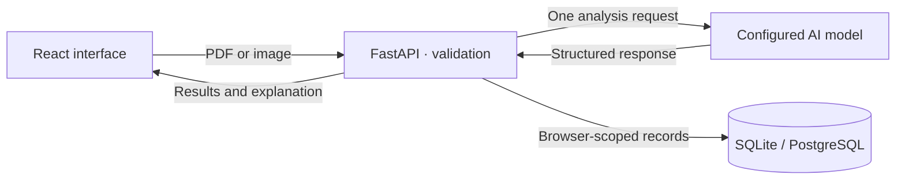

<p align="center">
  <picture>
    <source media="(prefers-color-scheme: dark)" srcset="docs/assets/medisense-wordmark-dark.svg">
    <source media="(prefers-color-scheme: light)" srcset="docs/assets/medisense-wordmark-light.svg">
    
  </picture>
</p>

<h1 align="center">Your results, made clear.</h1>

<p align="center">
  Lab reports and prescriptions, explained in everyday language.<br>
  A clearer starting point for your next conversation with a clinician.
</p>

<p align="center">
  <a href="#quick-start">Run locally</a> &nbsp;·&nbsp;
  <a href="#what-you-can-do">Explore features</a> &nbsp;·&nbsp;
  <a href="#how-it-works">Architecture</a> &nbsp;·&nbsp;
  <a href="#testing">Testing</a> &nbsp;·&nbsp;
  <a href="#configuration">Configuration</a>
</p>

<p align="center">
  <code>React + Vite</code> &nbsp; <code>FastAPI</code> &nbsp; <code>SQLite / PostgreSQL</code>
</p>


<p align="center"><sub>Actual application capture. The hero uses a scroll-controlled image sequence.</sub></p>

## Understanding comes first

A medical document can leave someone with more questions than answers. MediSense brings its measurements, medicine details and explanations into one readable experience, with useful questions to take into an appointment.

The project combines document analysis with an interface built around clarity: warm colors, careful typography, responsive layouts and motion that can be reduced or switched off.

> **Purpose:** MediSense supports understanding and conversation. It does not diagnose conditions, prescribe treatment, or replace a qualified clinician.

## What you can do

| Experience | What it provides |
| :--- | :--- |
| **Read a lab report** | Extracted measurements, supplied reference intervals, readable explanations and an attention filter. |
| **Understand a prescription** | Original medicine names, strengths and directions, with separate, concise AI-generated medicine information. |
| **Try before uploading** | Four illustrative report examples that work without an API key and do not create saved patient records. |
| **Prepare for an appointment** | Suggested clinician questions and specialist guidance for discussion. |
| **Keep the explanation** | A dedicated print summary, browser “Save as PDF,” text download, copying and sharing where supported. |
| **Return to a scan** | The latest 15 records for the current browser, with individual retrieval and deletion. |
| **Choose how it feels** | Light/dark themes, responsive layouts, a motion preference control and system reduced-motion support. |

**Accepted documents:** PDF, JPG/JPEG and PNG · **Maximum size:** 10 MB · **PDF limit:** 30 pages by default.

## Quick start

### 1. Install the prerequisites

- **Node.js 24 LTS**, including npm. The minimum supported version is Node.js 22.12.
- **Python 3.11 or newer**, including pip and `venv`.
- Internet access for dependency installation and real document analysis.

Download or clone the project, then open a terminal in its root folder—the one containing this README and `package.json`.

### 2. Set up the project

```sh
npm run setup
```

This installs the frontend from its lockfile, creates an isolated Python environment, installs the pinned backend dependencies and creates `backend/.env` from the safe template. **Existing configuration is preserved.**

SQLite is the default for a new installation. You do not need PostgreSQL, pgAdmin or a UI component subscription to run the project.

### 3. Enable document analysis

For real uploads, open `backend/.env` in your editor and replace the key placeholder:

```dotenv
GEMINI_API_KEY=your_actual_key_here
GEMINI_MODEL=gemini-3-flash-preview
DATABASE_BACKEND=sqlite
DATABASE_URL=
```

The model must be available to your Google AI Studio project, and the project must have quota. If necessary, select an available model in this private configuration. Keep the key on the backend; never place it in a `VITE_` variable or commit it.

**Just exploring?** You can leave the key unset and use the built-in samples, themes and interface. The current analysis integration uses Gemini; OpenRouter is not integrated.

### 4. Start MediSense

```sh
npm start
```

Open **[http://127.0.0.1:8000](http://127.0.0.1:8000)**. This command builds the frontend and serves the whole application through FastAPI. Keep the terminal open; **Ctrl+C** stops the app. SQLite creates the required local database and tables automatically.

For a first walkthrough, choose **Sample report**, open a lab example, compare **All results** with **Attention needed**, then explore the print and share tools. Samples stay separate from saved scan history.

<details>
<summary><strong>Using another port or Python installation</strong></summary>

If port 8000 is already in use:

```sh
npm start -- --port 8001
```

Then open [http://127.0.0.1:8001](http://127.0.0.1:8001).

To choose a Python executable when creating the environment:

```sh
npm run setup -- --python /path/to/python
```

Quote paths containing spaces. An existing virtual environment is reused. Do not copy `.venv` from another computer; create a new one with setup instead.

</details>

## How it works



1. **Choose a document.** The interface checks the selected file. The backend validates its size, extension, actual signature and PDF page count before analysis.
2. **Read and validate.** The analysis service returns structured data. Pydantic validates the result; unreadable or non-medical inputs are rejected instead of saved as successful scans.
3. **Explain with context.** Prescription information is generated in the same request and kept separate from the extracted directions. General adult reference guides are shown only for supported tests and matching units when a printed range is missing.
4. **Keep useful results.** Successful analyses are saved to the chosen database and returned to the interface for reading, printing or sharing. A failed history save is disclosed instead of presented as successful.

### The interface, considered

The hero scrubs through **240 source frames at 1920 × 1080**, with a bounded decoded working set and independent feature cards. GSAP ScrollTrigger coordinates scroll behavior; Lenis, Anime.js and spring-driven headings support the wider experience. The page adapts for smaller displays and offers a complete reduced-motion path.

### Built with

| Layer | Technology |
| :--- | :--- |
| Interface | React 19, Vite 8, reusable JSX/TSX components and CSS design tokens |
| Motion | GSAP / ScrollTrigger, Lenis, Anime.js, Framer Motion and React Spring |
| API and validation | FastAPI, Pydantic, HTTPX and pypdf |
| Document analysis | Gemini API, configured and called on the server |
| Storage | SQLAlchemy with SQLite locally or optional PostgreSQL |
| Checks | Python `unittest`, Node's test runner, Oxlint and Vite builds |

## Project structure

```text
MediSense/
├── backend/
│   ├── app/                 API, analysis, validation, storage and sample data
│   ├── tests/               Isolated backend tests
│   ├── .env.example         Safe configuration template
│   └── requirements.txt     Pinned runtime dependencies
├── frontend/
│   ├── src/                 Components, styles, hooks and utilities
│   ├── public/
│   │   ├── hero-frames/     The 240-frame hero sequence
│   │   ├── brand/           Production logo and favicon assets
│   │   └── fonts/           Local heading font and license
│   └── tests/               Frontend behavior and utility tests
├── docs/assets/             README wordmarks and application capture
├── scripts/                 Cross-platform setup and launch helpers
├── test_reports/            Fictional PDFs, ground truth and live benchmark
└── .github/workflows/       Windows and Linux checks for future pushes
```

## Development

```sh
npm run dev
```

The API runs at **[localhost:8000](http://127.0.0.1:8000)** and Vite at **[localhost:5173](http://127.0.0.1:5173)**, with live reload. Vite proxies `/api` to the backend. Stop an existing production server first if it is using port 8000. Ctrl+C stops both development processes.

| Command | Purpose |
| :--- | :--- |
| `npm run setup` | Install dependencies and create missing local configuration |
| `npm start` | Build and serve the complete application |
| `npm run dev` | Start the frontend and backend for development |
| `npm test` | Run backend and frontend tests |
| `npm run lint` | Check frontend source |
| `npm run build` | Create the production frontend in `frontend/dist` |

## Testing

```sh
npm test
npm run lint
npm run build
```

Backend tests use temporary SQLite databases and mocked AI responses. They do not consume provider quota or connect to a live PostgreSQL database. Frontend tests cover frame buffering, reverse scroll behavior, private history identity, upload handling, result filters, reference guides, sample reports, printing/sharing utilities and other interaction logic.

**Local handoff check · 28 October 2026:** 29 backend tests and 57 frontend tests passed. Lint and production builds passed, and a clean Windows installation was checked without private credentials or an existing database. The GitHub Actions workflow is configured for Windows and Linux; remote CI has not run yet.

<details>
<summary><strong>Run the optional live synthetic-document benchmark</strong></summary>

The [test_reports](test_reports/) folder includes fictional lab reports, fictional prescriptions and negative inputs. Expected extraction values are recorded in [ground_truth.json](test_reports/ground_truth.json).

This optional benchmark calls the configured analysis service and **consumes API quota**:

```sh
# Windows
backend/.venv/Scripts/python.exe test_reports/run_accuracy_tests.py

# macOS / Linux
backend/.venv/bin/python test_reports/run_accuracy_tests.py
```

It writes its own SQLite database, result files and an accuracy report. These outputs are ignored by Git. It does not use your application database or initialize PostgreSQL.

These clean synthetic inputs check extraction and application behavior. They do not establish clinical accuracy, handwriting reliability or diagnostic safety.

</details>

## Configuration

Use [backend/.env.example](backend/.env.example) as the reference. Your actual `backend/.env` stays private.

| Setting | What it controls |
| :--- | :--- |
| `GEMINI_API_KEY` | Backend-only access to document analysis |
| `GEMINI_MODEL` | A model available to the configured provider project |
| `DATABASE_BACKEND` | `sqlite` for local setup or `postgres` for PostgreSQL |
| `DATABASE_URL` | Optional connection URL; leave blank for the standard SQLite setup or individual PostgreSQL fields |
| `ALLOW_SQLITE_FALLBACK` | Whether PostgreSQL failures may fall back to local storage |
| `ANALYSES_PER_HOUR` | The process-local, per-IP analysis allowance |
| `CORS_ORIGINS` | Exact allowed frontend origins when hosting separately |
| `ADMIN_API_TOKEN` | Optional private token; administrative endpoints are disabled while blank |

<details>
<summary><strong>Use PostgreSQL instead of SQLite</strong></summary>

Create an empty PostgreSQL database, then update your private backend configuration:

```dotenv
DATABASE_BACKEND=postgres
DATABASE_URL=
POSTGRES_HOST=127.0.0.1
POSTGRES_PORT=5432
POSTGRES_USER=postgres
POSTGRES_PASSWORD=your_local_password
POSTGRES_DATABASE=medisense_db
ALLOW_SQLITE_FALLBACK=False
```

Restart the app. It creates its tables automatically. Check [the health endpoint](http://127.0.0.1:8000/api/health) for connectivity. If `DATABASE_URL` is set, it takes precedence over the individual PostgreSQL fields. Switching database configuration does not move existing records automatically.

</details>

<details>
<summary><strong>Deployment and separate frontend hosting</strong></summary>

FastAPI serves `frontend/dist` when a build exists, so the frontend and API can share one origin. `npm start` binds to localhost for local evaluation; public hosting needs an appropriate server configuration.

For separate frontend hosting, set `VITE_API_BASE` to the backend origin, without `/api`, before building. Set `CORS_ORIGINS` to the exact frontend origin and `ALLOW_LOCAL_ORIGINS=False` on the backend. `VITE_API_PROXY_TARGET` can override the development proxy target.

Use HTTPS, persistent storage, private secret management and deployment-appropriate access, retention and backup policies. The built-in analysis limiter is process-local; deployments with multiple instances need a shared or edge limiter.

</details>

## Data, privacy and medical context

- **History belongs to a browser profile.** A random browser token scopes access; the database stores its hash. There is no user login, cross-device history or account recovery. Clearing browser storage loses access, and sharing a browser profile shares its history.
- **The AI service receives the document.** Upload content is sent for analysis only when the user chooses to analyze it. API keys remain on the backend.
- **Medicine explanations are not independent verification.** AI-generated information may be incomplete or incorrect. Confirm medicine questions with a clinician or pharmacist; original prescription details are kept separate.
- **Reference guides are contextual.** Printed laboratory intervals take precedence. General adult examples are not universal, pediatric, pregnancy-specific or personalized ranges, and they do not assign a new clinical status.
- **Demonstrations are identified.** Bundled reports use fictional data. Sample testimonials are illustrative rather than verified user feedback.
- **Private files stay out of Git.** Environment files, databases, backups, installed dependencies, builds, local tools and cleanup archives are ignored. Keep real patient documents out of the repository.

## Troubleshooting

| Problem | Next step |
| :--- | :--- |
| Analysis is not configured | Add a valid backend API key and restart. You can still explore samples. |
| The analysis service rejects its configuration | Confirm the key, selected model and API access for that provider project. |
| Request limit reached | Check the provider project's quota and reset window. Another key in the same project does not create a new quota. |
| PostgreSQL cannot connect | Check local credentials, or use the default SQLite configuration for evaluation. |
| Port 8000 is busy | Stop the earlier server or run `npm start -- --port 8001`. |
| Python or Node is missing | Install the supported runtimes, reopen the terminal and rerun setup. |
| Installation fails | Check network access and runtime versions. Linux may need the operating system's Python `venv` package. |

## Brand and assets

MediSense uses its existing **Folio** symbol, warm brown/orange accents and a carefully spaced wordmark. The README includes light and dark vector lockups and a capture of the real application. The wordmark is outlined from the bundled **Onest** font so it displays without an external font request.

Onest is distributed under the [SIL Open Font License](frontend/public/fonts/onest/OFL.txt). The application also uses Manrope and Source Serif 4 through Google Fonts, with fallback fonts when the network is unavailable.

---

<p align="center"><strong>MediSense</strong><br><sub>For understanding and conversation. Always review medical information with a qualified clinician.</sub></p>
