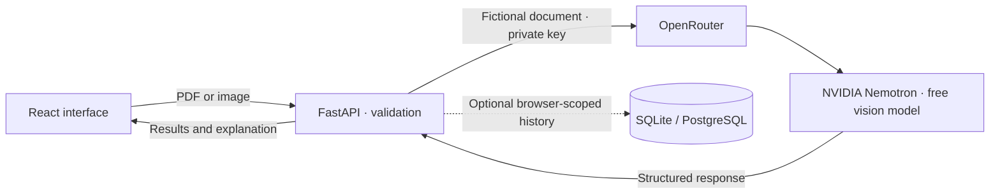

<p align="center">
  <picture>
    <source media="(prefers-color-scheme: dark)" srcset="docs/assets/medisense-wordmark-dark.svg">
    <source media="(prefers-color-scheme: light)" srcset="docs/assets/medisense-wordmark-light.svg">
    
  </picture>
</p>

<h1 align="center">Your results, made clear.</h1>

<p align="center">
  Lab reports and prescriptions, explained in everyday language.<br>
  A clearer starting point for your next conversation with a clinician.
</p>

<p align="center">
  <a href="#quick-start">Run locally</a> &nbsp;·&nbsp;
  <a href="#what-you-can-do">Explore features</a> &nbsp;·&nbsp;
  <a href="#how-it-works">Architecture</a> &nbsp;·&nbsp;
  <a href="#checks">Checks</a> &nbsp;·&nbsp;
  <a href="#configuration">Configuration</a>
</p>

<p align="center">
  <code>React + Vite</code> &nbsp; <code>FastAPI</code> &nbsp; <code>NVIDIA Nemotron</code> &nbsp; <code>OpenRouter</code>
</p>

<p align="center"><a href="LICENSE">MIT licensed · Open source</a></p>

## Watch MediSense

https://github.com/user-attachments/assets/3ff8b286-e4eb-4e2c-9cb5-9242625ddaa2

A 1080p introduction with music, the capsule and DNA visuals, and illustrative sample-report screens.

## Understanding comes first

A medical document can leave someone with more questions than answers. MediSense brings its measurements, medicine details and explanations into one readable experience, with useful questions to take into an appointment.

The project combines document analysis with an interface built around clarity: warm colors, careful typography, responsive layouts and motion that can be reduced or switched off.

**Powered by NVIDIA Nemotron through OpenRouter.** Uploaded demonstration documents are read by `nvidia/nemotron-3.5-super-vl:free`; FastAPI validates the structured response before showing measurements, medicine information and a plain-language explanation. The model runs on the backend, with no API key exposed to the browser.

> **Free-model demo:** use fictional documents only, with no personal or confidential information. The [free model's data policy](https://openrouter.ai/nvidia/nemotron-3.5-super-vl:free) permits input logging and excludes personal or confidential data. MediSense requires confirmation before sending an upload. Built-in sample reports remain available without calling an AI service.

> **Purpose:** MediSense supports understanding and conversation. It does not diagnose conditions, prescribe treatment, or replace a qualified clinician.

## What you can do

| Experience | What it provides |
| :--- | :--- |
| **Read a lab report** | Extracted measurements, supplied reference intervals, readable explanations and an attention filter. |
| **Understand a prescription** | Original medicine names, strengths and directions, with separate, concise AI-generated medicine information. |
| **Try before uploading** | Four illustrative report examples that work without an API key and do not create saved patient records. |
| **Prepare for an appointment** | Suggested clinician questions and specialist guidance for discussion. |
| **Keep the explanation** | A dedicated print summary, browser “Save as PDF,” text download, copying and sharing where supported. |
| **Return to a scan** | With a database connected, the latest 15 records for the current browser, with individual retrieval and deletion. The hosted demo can run without saved history. |
| **Choose how it feels** | Light/dark themes, responsive layouts, a motion preference control and system reduced-motion support. |

**Accepted documents:** PDF, JPG/JPEG and PNG · **Maximum size:** 10 MB locally, 4 MB on Vercel · **PDF limit:** 30 pages by default.

## Quick start

### 1. Install the prerequisites

- **Node.js 24 LTS**, including npm. The minimum supported version is Node.js 22.12.
- **Python 3.11 or newer**, including pip and `venv`.
- Internet access for dependency installation and real document analysis.

Download or clone the project, then open a terminal in its root folder—the one containing this README and `package.json`.

### 2. Set up the project

```sh
npm run setup
```

This installs the frontend from its lockfile, creates an isolated Python environment, installs the pinned backend dependencies and creates `backend/.env` from the safe template. **Existing configuration is preserved.**

SQLite is the default for a new installation. You do not need PostgreSQL, pgAdmin or a UI component subscription to run the project.

### 3. Enable document analysis

For live analysis of fictional samples, open `backend/.env` in your editor and replace the key placeholder:

```dotenv
ANALYSIS_PROVIDER=openrouter
OPENROUTER_API_KEY=your_openrouter_key_here
OPENROUTER_MODEL=nvidia/nemotron-3.5-super-vl:free
OPENROUTER_BASE_URL=https://openrouter.ai/api/v1
DATABASE_BACKEND=sqlite
DATABASE_URL=
```

Create a key in your [OpenRouter account](https://openrouter.ai/settings/keys). The selected free NVIDIA Nemotron model must be available and your account must have remaining request quota. This integration accepts free Nemotron model IDs and sets a zero-price inference cap; it does not fall back to paid models. Free availability and request limits can change.

Keep the key on the backend; never place it in a `VITE_` variable or commit it. Upload only fictional documents and confirm this in the upload form before choosing **Analyze document**.

**Just exploring?** Leave the key unset and use the built-in samples, themes and interface. Legacy Gemini support remains available only when explicitly selected with `ANALYSIS_PROVIDER=gemini`; Nemotron is the default and there is no automatic provider fallback.

### 4. Start MediSense

```sh
npm start
```

Open **[http://127.0.0.1:8000](http://127.0.0.1:8000)**. This command builds the frontend and serves the whole application through FastAPI. Keep the terminal open; **Ctrl+C** stops the app. SQLite creates the required local database and tables automatically.

For a first walkthrough, choose **Sample report**, open a lab example, compare **All results** with **Attention needed**, then explore the print and share tools. Samples stay separate from saved scan history.

<details>
<summary><strong>Using another port or Python installation</strong></summary>

If port 8000 is already in use:

```sh
npm start -- --port 8001
```

Then open [http://127.0.0.1:8001](http://127.0.0.1:8001).

To choose a Python executable when creating the environment:

```sh
npm run setup -- --python /path/to/python
```

Quote paths containing spaces. An existing virtual environment is reused. Do not copy `.venv` from another computer; create a new one with setup instead.

</details>

## How it works



1. **Choose a fictional document.** The interface checks the selected file and requires confirmation that it contains no personal or confidential information. The backend validates its size, extension, actual signature and PDF page count before analysis.
2. **Read and validate.** NVIDIA Nemotron reads the document through OpenRouter and returns structured data. Pydantic validates the result; unreadable or non-medical inputs are rejected instead of saved as successful scans.
3. **Explain with context.** Prescription information is generated in the same request and kept separate from the extracted directions. General adult reference guides are shown only for supported tests and matching units when a printed range is missing.
4. **Keep useful results.** Results return for reading, printing or sharing. When a database is connected, successful analyses are saved to browser-scoped history. Without a hosted database, the Vercel demo returns explanations without saving them and makes that limitation visible.

### The interface, considered

The hero scrubs through **240 source frames at 1920 × 1080**, with a bounded decoded working set and independent feature cards. GSAP ScrollTrigger coordinates scroll behavior; Lenis, Anime.js and spring-driven headings support the wider experience. The page adapts for smaller displays and offers a complete reduced-motion path.

### Built with

| Layer | Technology |
| :--- | :--- |
| Interface | React 19, Vite 8, reusable JSX/TSX components and CSS design tokens |
| Motion | GSAP / ScrollTrigger, Lenis, Anime.js, Framer Motion and React Spring |
| API and validation | FastAPI, Pydantic, HTTPX and pypdf |
| Document analysis | NVIDIA Nemotron 3.5 Super VL through OpenRouter, called on the server |
| Storage | SQLAlchemy with SQLite locally or optional PostgreSQL |
| Checks | Oxlint and Vite builds |

## Project structure

```text
MediSense/
├── backend/
│   ├── app/                 API, analysis, validation, storage and sample data
│   ├── .env.example         Safe configuration template
│   └── requirements.txt     Pinned runtime dependencies
├── frontend/
│   ├── src/                 Components, styles, hooks and utilities
│   └── public/
│       ├── hero-frames/     Original frames and local static fallback
│       ├── brand/           Production logo and favicon assets
│       └── fonts/           Local heading font and license
├── docs/assets/             README wordmarks
├── scripts/                 Cross-platform setup and launch helpers
└── .github/workflows/       Windows and Linux checks for future pushes
```

## Development

```sh
npm run dev
```

The API runs at **[localhost:8000](http://127.0.0.1:8000)** and Vite at **[localhost:5173](http://127.0.0.1:5173)**, with live reload. Vite proxies `/api` to the backend. Stop an existing production server first if it is using port 8000. Ctrl+C stops both development processes.

| Command | Purpose |
| :--- | :--- |
| `npm run setup` | Install dependencies and create missing local configuration |
| `npm start` | Build and serve the complete application |
| `npm run dev` | Start the frontend and backend for development |
| `npm run lint` | Check frontend source |
| `npm test` | Check the cross-platform startup helper's JavaScript syntax |
| `npm run build` | Create the production frontend in `frontend/dist` |

## Checks

```sh
npm test
npm run lint
npm run build
```

GitHub Actions runs these checks on Windows and Linux. They verify startup-helper syntax, source linting and compilation; they do not establish clinical accuracy or live service availability. `npm test` is a syntax check, not a unit-test suite.

## Configuration

Use [backend/.env.example](backend/.env.example) as the reference. Your actual `backend/.env` stays private.

| Setting | What it controls |
| :--- | :--- |
| `ANALYSIS_PROVIDER` | `openrouter` by default; `gemini` only for explicit legacy use |
| `OPENROUTER_API_KEY` | Private, backend-only OpenRouter key |
| `OPENROUTER_MODEL` | `nvidia/nemotron-3.5-super-vl:free`; must be a free NVIDIA Nemotron model |
| `OPENROUTER_BASE_URL` | `https://openrouter.ai/api/v1`; only the official endpoint is accepted |
| `OPENROUTER_TIMEOUT_SECONDS` | Analysis timeout, 90 seconds by default |
| `DATABASE_BACKEND` | `sqlite` for local setup or `postgres` for PostgreSQL |
| `DATABASE_URL` | Optional connection URL; leave blank for the standard SQLite setup or individual PostgreSQL fields |
| `ALLOW_SQLITE_FALLBACK` | Whether PostgreSQL failures may fall back to local storage |
| `ALLOW_STATELESS_ANALYSIS` | Allow Vercel to analyze fictional samples when no `DATABASE_URL` is configured; no saved history |
| `ANALYSES_PER_HOUR` | Per-IP rolling-hour allowance; database-shared with storage, per instance in stateless mode |
| `MAX_UPLOAD_BYTES` | Upload allowance: 10 MB locally, 4 MB by default on Vercel |
| `CORS_ORIGINS` | Exact allowed frontend origins when hosting separately |
| `ADMIN_API_TOKEN` | Optional private token; administrative endpoints are disabled while blank |

<details>
<summary><strong>Use PostgreSQL instead of SQLite</strong></summary>

Create an empty PostgreSQL database, then update your private backend configuration:

```dotenv
DATABASE_BACKEND=postgres
DATABASE_URL=
POSTGRES_HOST=127.0.0.1
POSTGRES_PORT=5432
POSTGRES_USER=postgres
POSTGRES_PASSWORD=your_local_password
POSTGRES_DATABASE=medisense_db
ALLOW_SQLITE_FALLBACK=False
```

Restart the app. It creates its tables automatically. Check [the health endpoint](http://127.0.0.1:8000/api/health) for connectivity. If `DATABASE_URL` is set, it takes precedence over the individual PostgreSQL fields. Switching database configuration does not move existing records automatically.

</details>

<details>
<summary><strong>Deployment and separate frontend hosting</strong></summary>

FastAPI serves `frontend/dist` when a build exists, so the frontend and API can share one origin. `npm start` binds to localhost for local evaluation; public hosting needs an appropriate server configuration.

For separate frontend hosting, set `VITE_API_BASE` to the backend origin, without `/api`, before building. Set `CORS_ORIGINS` to the exact frontend origin and `ALLOW_LOCAL_ORIGINS=False` on the backend. `VITE_API_PROXY_TARGET` can override the development proxy target.

Use HTTPS, private secret management and deployment-appropriate access, retention and backup policies. With a database, the analysis limiter stores hashed client addresses and request timestamps so instances share the same allowance. In stateless mode, the limiter is best-effort per instance; OpenRouter's separate account quota also applies.

**Vercel backend:** use `backend` as the project root, the FastAPI framework preset and its automatic build settings. The included `backend/vercel.json` configures `app/main.py` with a 120-second maximum duration. Python 3.12 is selected by `.python-version`.

Set these in the backend project's Vercel environment settings before deploying:

| Variable | Value |
| :--- | :--- |
| `DATABASE_BACKEND` | `postgres` |
| `DATABASE_URL` | Leave unset for demo analysis without history, or supply your own hosted PostgreSQL connection with SSL |
| `ALLOW_SQLITE_FALLBACK` | `False` |
| `ALLOW_STATELESS_ANALYSIS` | `True` for the demo without a database |
| `ANALYSIS_PROVIDER` | `openrouter` |
| `OPENROUTER_API_KEY` | Your private OpenRouter key, stored as a Secret; never use a `VITE_` prefix |
| `OPENROUTER_MODEL` | `nvidia/nemotron-3.5-super-vl:free` |
| `CORS_ORIGINS` | The exact public frontend origin, without a trailing slash |
| `ALLOW_LOCAL_ORIGINS` | `False` |
| `MAX_UPLOAD_BYTES` | `4194304` |

The database on a laptop is not reachable by Vercel through `localhost`. Your local app can continue using local PostgreSQL. Set the deployed backend's `DATABASE_URL` only when you have a PostgreSQL server reachable from Vercel; no database is provisioned by this repository. Local SQLite or fallback storage is rejected on Vercel.

The API can be deployed before a database is connected: `/` and illustrative samples remain available, while `/api/health` reports `degraded`, `database.connected: false`, `analysis_mode: stateless_demo` and `history_available: false`. With `ALLOW_STATELESS_ANALYSIS=True`, fictional uploads are analyzed without saving history. History endpoints remain unavailable. Set it to `False` to require storage for uploads.

To enable history later, set your own reachable `DATABASE_URL` and redeploy. New tables are created automatically after a database is connected; existing laptop records are not uploaded. No database service is provisioned by this project.

Vercel's direct request-body limit is 4.5 MB. This app allows 4 MB on Vercel to leave room for the upload form. The updated frontend reads that allowance from `/api/health`; publish the frontend update with `VITE_API_BASE` set to the backend origin. Local use keeps its 10 MB default.

After deployment, check `/api/health` for `analysis_provider: openrouter`, the selected Nemotron model and `analysis_configured: true`, then verify a fictional image upload. Check browser-scoped history separately only when storage is connected. The deployment is not verified merely because the build succeeds.

</details>

## Data, privacy and medical context

- **History belongs to a browser profile.** A random browser token scopes access; the database stores its hash. There is no user login, cross-device history or account recovery. Clearing browser storage loses access, and sharing a browser profile shares its history.
- **The AI service receives the document.** Upload content is sent through OpenRouter to the free NVIDIA endpoint only when the user confirms a fictional sample and chooses to analyze it. This is not a confidential patient-data service. API keys remain on the backend.
- **History needs storage.** The hosted stateless demo does not save uploads or explanations to a database. The analysis provider's own data policy still applies; no-history mode is not a promise of provider-side deletion.
- **Medicine explanations are not independent verification.** AI-generated information may be incomplete or incorrect. Confirm medicine questions with a clinician or pharmacist; original prescription details are kept separate.
- **Reference guides are contextual.** Printed laboratory intervals take precedence. General adult examples are not universal, pediatric, pregnancy-specific or personalized ranges, and they do not assign a new clinical status.
- **Demonstrations are identified.** Bundled reports use fictional data. Sample testimonials are illustrative rather than verified user feedback.
- **Private files stay out of Git.** Environment files, databases, backups, installed dependencies, builds, local tools and cleanup archives are ignored. Keep real patient documents out of the repository.

## Troubleshooting

| Problem | Next step |
| :--- | :--- |
| Analysis is not configured | Add a valid backend API key and restart. You can still explore samples. |
| Upload confirmation is required | Use a fictional sample containing no personal or confidential information, then check the confirmation box. |
| The analysis service rejects its configuration | Confirm the key, selected model and API access for that provider project. |
| Request limit reached | Check the OpenRouter account's free-model quota and availability. A new key in the same account does not create a new quota. |
| PostgreSQL cannot connect | Check local credentials, or use the default SQLite configuration for evaluation. |
| Port 8000 is busy | Stop the earlier server or run `npm start -- --port 8001`. |
| Python or Node is missing | Install the supported runtimes, reopen the terminal and rerun setup. |
| Installation fails | Check network access and runtime versions. Linux may need the operating system's Python `venv` package. |

## Brand and assets

MediSense uses its existing **Folio** symbol, warm brown/orange accents and a carefully spaced wordmark. The README includes light and dark vector lockups and a capture of the real application. The wordmark is outlined from the bundled **Onest** font so it displays without an external font request.

Onest is distributed under the [SIL Open Font License](frontend/public/fonts/onest/OFL.txt). The application also uses Manrope and Source Serif 4 through Google Fonts, with fallback fonts when the network is unavailable.

---

<p align="center"><strong>MediSense</strong><br><sub>For understanding and conversation. Always review medical information with a qualified clinician.</sub></p>
