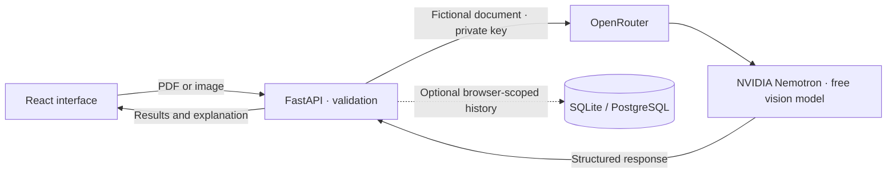

<p align="center">
  <picture>
    <source media="(prefers-color-scheme: dark)" srcset="docs/assets/medisense-wordmark-dark.svg">
    <source media="(prefers-color-scheme: light)" srcset="docs/assets/medisense-wordmark-light.svg">
    
  </picture>
</p>

<h1 align="center">Your results, made clear.</h1>

<p align="center">
  <a href="https://react.dev">&nbsp;<strong>React</strong></a>
  &nbsp;&nbsp;&nbsp;
  <a href="https://vite.dev">&nbsp;<strong>Vite</strong></a>
  &nbsp;&nbsp;&nbsp;
  <a href="https://fastapi.tiangolo.com">&nbsp;<strong>FastAPI</strong></a>
  &nbsp;&nbsp;&nbsp;
  <a href="https://build.nvidia.com">&nbsp;<strong>NVIDIA Nemotron</strong></a>
  &nbsp;&nbsp;&nbsp;
  <a href="https://openrouter.ai">&nbsp;<strong>OpenRouter</strong></a>
</p>

<p align="center">
  <a href="#quick-start">Run locally</a> &nbsp;·&nbsp;
  <a href="#what-you-can-do">Explore features</a> &nbsp;·&nbsp;
  <a href="#how-it-works">Architecture</a> &nbsp;·&nbsp;
  <a href="#checks">Checks</a> &nbsp;·&nbsp;
  <a href="#configuration">Configuration</a> &nbsp;·&nbsp;
  <a href="LICENSE">MIT licensed · Open source</a>
</p>

<br>

<p align="center">
  <picture>
    <source media="(prefers-color-scheme: dark)" srcset="docs/assets/section-divider-dark.svg">
    <source media="(prefers-color-scheme: light)" srcset="docs/assets/section-divider-light.svg">
    
  </picture>
</p>

## 🎬 Watch MediSense

https://github.com/user-attachments/assets/3ff8b286-e4eb-4e2c-9cb5-9242625ddaa2

A 1080p walkthrough featuring the hero visuals and sample-report views.

<br>

<p align="center">
  <picture>
    <source media="(prefers-color-scheme: dark)" srcset="docs/assets/section-divider-dark.svg">
    <source media="(prefers-color-scheme: light)" srcset="docs/assets/section-divider-light.svg">
    
  </picture>
</p>

## 💡 Understanding comes first

MediSense turns lab reports and prescriptions into clear explanations, organized measurements, and helpful questions for your clinician—backed by **NVIDIA Nemotron** via **OpenRouter** on the server.

> ⚠️ **Free-model demo:** Upload **fictional documents only** (no personal or confidential data). The [free model policy](https://openrouter.ai/nvidia/nemotron-3.5-super-vl:free) permits logging. Built-in sample reports work without an API key.

> 🩺 **Medical disclaimer:** MediSense supports understanding and conversation only. It does not diagnose, prescribe, or replace a qualified clinician.

<br>

<p align="center">
  <a id="what-you-can-do"></a>
  <picture>
    <source media="(prefers-color-scheme: dark)" srcset="docs/assets/section-divider-dark.svg">
    <source media="(prefers-color-scheme: light)" srcset="docs/assets/section-divider-light.svg">
    
  </picture>
</p>

## ✨ What you can do

| Feature | Summary |
| :--- | :--- |
| **Read a lab report** | Extracted measurements, printed ranges, plain-language notes, and an attention filter. |
| **Understand a prescription** | Medicine names, strengths, and directions alongside separate AI drug summaries. |
| **Try built-in samples** | Four illustrative reports that work with no API key and save no patient records. |
| **Prepare for appointments** | Suggested clinician questions and specialist guidance. |
| **Export & share** | Print summary, Save as PDF, text download, copy, and share. |
| **Browser scan history** | Stores the latest 15 browser-scoped scans when a database is connected. |
| **Adaptive UI** | Light/dark themes, responsive layout, and reduced-motion controls. |

**Accepted uploads:** PDF, JPG/JPEG, PNG · **Max size:** 10 MB locally (`4 MB` on Vercel) · **Max PDF pages:** 30.

<br>

<p align="center">
  <a id="quick-start"></a>
  <picture>
    <source media="(prefers-color-scheme: dark)" srcset="docs/assets/section-divider-dark.svg">
    <source media="(prefers-color-scheme: light)" srcset="docs/assets/section-divider-light.svg">
    
  </picture>
</p>

## 🚀 Quick start

### 1. Prerequisites
- **Node.js 24 LTS** (minimum `22.12`) and **Python 3.11+** (`pip` + `venv`).

### 2. Install
```sh
npm run setup
```
Installs frontend and backend dependencies, creates a Python `.venv`, and initializes `backend/.env` with SQLite by default.

### 3. Enable document analysis *(optional)*
Built-in samples work out of the box with **no API key**. To analyze uploaded fictional documents, add an [OpenRouter key](https://openrouter.ai/settings/keys) to `backend/.env` (kept server-side only):

```dotenv
ANALYSIS_PROVIDER=openrouter
OPENROUTER_API_KEY=your_openrouter_key_here
OPENROUTER_MODEL=nvidia/nemotron-3.5-super-vl:free
```

*(Legacy Gemini support is also available via `ANALYSIS_PROVIDER=gemini`.)*

### 4. Start MediSense
```sh
npm start
```
Builds the frontend and serves the app at **[http://127.0.0.1:8000](http://127.0.0.1:8000)**.

<details>
<summary><strong>Custom port or Python path</strong></summary>

```sh
npm start -- --port 8001
npm run setup -- --python /path/to/python
```

</details>

<br>

<p align="center">
  <a id="how-it-works"></a>
  <picture>
    <source media="(prefers-color-scheme: dark)" srcset="docs/assets/section-divider-dark.svg">
    <source media="(prefers-color-scheme: light)" srcset="docs/assets/section-divider-light.svg">
    
  </picture>
</p>

## ⚙️ How it works



1. **Validate:** Frontend and backend verify file type, size, signature, and PDF page count (with fictional-data confirmation).
2. **Analyze:** FastAPI sends the document to NVIDIA Nemotron via OpenRouter and validates structured JSON with Pydantic.
3. **Contextualize:** Medicine info stays separate from extracted prescription directions; reference guides fill missing ranges when supported.
4. **Return & store:** Results are shown immediately and optionally saved to SQLite or PostgreSQL (browser-scoped).

The hero scrubs **240 frames at 1920×1080** using GSAP ScrollTrigger and provides a static reduced-motion mode.

<br>

### 🧱 Built with

| Layer | Technologies |
| :--- | :--- |
| **Interface** | <a href="https://react.dev">&nbsp;React 19</a> &nbsp;·&nbsp; <a href="https://vite.dev">&nbsp;Vite 8</a> &nbsp;·&nbsp; <a href="https://www.typescriptlang.org">&nbsp;JSX / TSX</a> &nbsp;·&nbsp; <a href="https://developer.mozilla.org/en-US/docs/Web/CSS">&nbsp;CSS</a> |
| **Motion** | <a href="https://gsap.com">&nbsp;GSAP / ScrollTrigger</a> &nbsp;·&nbsp; <a href="https://lenis.dev">&nbsp;Lenis</a> &nbsp;·&nbsp; <a href="https://animejs.com">&nbsp;Anime.js</a> &nbsp;·&nbsp; <a href="https://motion.dev">&nbsp;Framer Motion</a> &nbsp;·&nbsp; <a href="https://www.react-spring.dev">&nbsp;React Spring</a> |
| **API & Validation** | <a href="https://fastapi.tiangolo.com">&nbsp;FastAPI</a> &nbsp;·&nbsp; <a href="https://docs.pydantic.dev">&nbsp;Pydantic</a> &nbsp;·&nbsp; <a href="https://www.python-httpx.org">&nbsp;HTTPX</a> &nbsp;·&nbsp; <a href="https://pypdf.readthedocs.io/en/latest/">&nbsp;pypdf</a> |
| **Document Analysis** | <a href="https://build.nvidia.com">&nbsp;NVIDIA Nemotron 3.5 Super VL</a> &nbsp;·&nbsp; <a href="https://openrouter.ai">&nbsp;OpenRouter</a> |
| **Storage** | <a href="https://www.sqlalchemy.org">&nbsp;SQLAlchemy</a> &nbsp;·&nbsp; <a href="https://www.sqlite.org">&nbsp;SQLite</a> &nbsp;·&nbsp; <a href="https://www.postgresql.org">&nbsp;PostgreSQL</a> |
| **Checks** | <a href="https://oxc.rs">&nbsp;Oxlint</a> &nbsp;·&nbsp; <a href="https://vite.dev">&nbsp;Vite</a> |

<br>

<p align="center">
  <picture>
    <source media="(prefers-color-scheme: dark)" srcset="docs/assets/section-divider-dark.svg">
    <source media="(prefers-color-scheme: light)" srcset="docs/assets/section-divider-light.svg">
    
  </picture>
</p>

## 📁 Project structure

```text
MediSense/
├── backend/              FastAPI app, AI provider integration, validation & DB
├── frontend/             React UI, hero frames, brand assets & fonts
├── docs/assets/          README wordmarks & dividers
├── scripts/              Cross-platform setup & start scripts
└── .github/workflows/    Windows and Linux CI checks
```

<br>

<p align="center">
  <a id="checks"></a>
  <picture>
    <source media="(prefers-color-scheme: dark)" srcset="docs/assets/section-divider-dark.svg">
    <source media="(prefers-color-scheme: light)" srcset="docs/assets/section-divider-light.svg">
    
  </picture>
</p>

## ✅ Checks

```sh
npm test
npm run lint
npm run build
```

GitHub Actions runs these on Windows and Linux to verify helper syntax, frontend linting, and production bundling.

<br>

<p align="center">
  <a id="configuration"></a>
  <picture>
    <source media="(prefers-color-scheme: dark)" srcset="docs/assets/section-divider-dark.svg">
    <source media="(prefers-color-scheme: light)" srcset="docs/assets/section-divider-light.svg">
    
  </picture>
</p>

## 🔧 Configuration

See [backend/.env.example](backend/.env.example) for all options (`backend/.env` stays private).

| Variable | Purpose |
| :--- | :--- |
| `ANALYSIS_PROVIDER` | `openrouter` (default) or `gemini` |
| `OPENROUTER_API_KEY` | Private OpenRouter API key (backend-only) |
| `OPENROUTER_MODEL` | `nvidia/nemotron-3.5-super-vl:free` |
| `OPENROUTER_BASE_URL` | `https://openrouter.ai/api/v1` |
| `OPENROUTER_TIMEOUT_SECONDS` | Request timeout (`90`s default) |
| `DATABASE_BACKEND` | `sqlite` (local default) or `postgres` |
| `DATABASE_URL` | Hosted/custom DB URL (overrides individual Postgres vars) |
| `ALLOW_SQLITE_FALLBACK` | Fall back to SQLite if Postgres fails |
| `ALLOW_STATELESS_ANALYSIS` | Allow analysis without a DB (no saved history) |
| `ANALYSES_PER_HOUR` | Per-IP rolling hourly limit |
| `MAX_UPLOAD_BYTES` | `10485760` locally (`4194304` on Vercel) |
| `CORS_ORIGINS` | Allowed frontend origins when hosted separately |
| `ADMIN_API_TOKEN` | Optional admin token (disabled when blank) |

<details>
<summary><strong>🐘 Use PostgreSQL instead of SQLite</strong></summary>

```dotenv
DATABASE_BACKEND=postgres
DATABASE_URL=
POSTGRES_HOST=127.0.0.1
POSTGRES_PORT=5432
POSTGRES_USER=postgres
POSTGRES_PASSWORD=your_local_password
POSTGRES_DATABASE=medisense_db
ALLOW_SQLITE_FALLBACK=False
```

Restart the app to auto-create tables and verify `/api/health`.

</details>

<details>
<summary><strong>▲ Deployment & separate frontend hosting</strong></summary>

- **Single origin:** FastAPI serves `frontend/dist` automatically when built.
- **Separate frontend:** Set `VITE_API_BASE` (without `/api`) before building, and configure `CORS_ORIGINS` + `ALLOW_LOCAL_ORIGINS=False` on the backend.
- **Vercel backend:** Set root directory to `backend` (`backend/vercel.json` sets a 120s limit and `.python-version` selects Python 3.12). Use `4194304` (`4 MB`) for `MAX_UPLOAD_BYTES` due to Vercel's 4.5 MB payload cap.
- **Stateless demo mode:** Set `ALLOW_STATELESS_ANALYSIS=True` and `ALLOW_SQLITE_FALLBACK=False` if deploying without a remote `DATABASE_URL` (connect a hosted Postgres SSL URL later to enable history), then verify `/api/health`.

</details>

<br>

<p align="center">
  <picture>
    <source media="(prefers-color-scheme: dark)" srcset="docs/assets/section-divider-dark.svg">
    <source media="(prefers-color-scheme: light)" srcset="docs/assets/section-divider-light.svg">
    
  </picture>
</p>

## 🔒 Data, privacy & medical context

- **Browser-scoped history:** Saved scans use a random browser token hash (no login/sync; clearing browser data drops access).
- **Third-party processing:** Files are sent to the configured AI provider only after upload confirmation; API keys stay on the backend.
- **Not clinical advice:** Always verify lab ranges and medication details with a clinician or pharmacist.
- **Demo content:** Bundled samples and testimonials are fictional/illustrative; secrets and local databases stay ignored from Git.

<br>

<p align="center">
  <picture>
    <source media="(prefers-color-scheme: dark)" srcset="docs/assets/section-divider-dark.svg">
    <source media="(prefers-color-scheme: light)" srcset="docs/assets/section-divider-light.svg">
    
  </picture>
</p>

## 🛠️ Troubleshooting

| Issue | Fix |
| :--- | :--- |
| Analysis not configured | Add a valid API key in `backend/.env` and restart (or use sample reports). |
| Confirmation required | Confirm the uploaded document is fictional before analyzing. |
| Provider / quota errors | Verify your OpenRouter key, selected free Nemotron model, and remaining quota. |
| PostgreSQL connection failed | Check DB credentials or switch back to `DATABASE_BACKEND=sqlite`. |
| Port 8000 busy | Stop the other server or run `npm start -- --port 8001`. |
| Setup fails | Verify Node.js 22.12+ / Python 3.11+ (`venv` package on Linux) and internet access. |

<br>

<p align="center">
  <picture>
    <source media="(prefers-color-scheme: dark)" srcset="docs/assets/section-divider-dark.svg">
    <source media="(prefers-color-scheme: light)" srcset="docs/assets/section-divider-light.svg">
    
  </picture>
</p>

<p align="center">
  <picture>
    <source media="(prefers-color-scheme: dark)" srcset="docs/assets/medisense-wordmark-dark.svg">
    <source media="(prefers-color-scheme: light)" srcset="docs/assets/medisense-wordmark-light.svg">
    
  </picture>
  <br>
  <sub>For understanding and conversation. Always review medical information with a qualified clinician.</sub>
</p>
